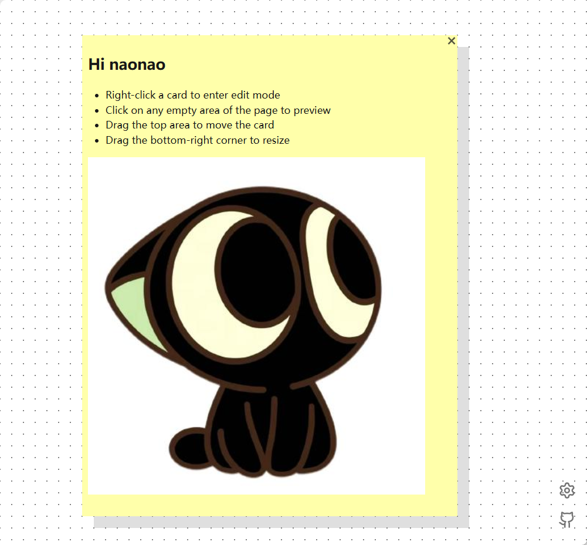

# [Sticky Board](https://sticky-web.netlify.app/)

[English](./README.md) | [中文](./README-zh.md)

A clean and elegant web-based sticky notes board that supports drag-and-drop operations, grid snapping, and Markdown syntax.

All data is stored locally only. No account required, no synchronization needed — just open and use.

## ✨ Features

- 🔒 **Local Storage** – All data is stored only in the browser
- 📄 **Markdown** – Write content using Markdown syntax with preview support
- ⌨️ **Quick Editing** – Right-click a card to edit, click any blank area or press Esc to preview
- ✏️ **Edit / Preview Toggle** – Switch a note between edit and preview from the top-bar button
- 📋 **Copy Code** – Preview code blocks include a one-click copy button
- 🖼️ **Paste Images** – Paste images from clipboard into Markdown (limit: 20MB per image)
- 📐 **Grid Alignment** – Cards snap to a grid when moving or resizing
- 🗖 **Maximize Note** – Expand a single note to fill the viewport, restore it with one click
- 🗓️ **Timeline Layout** – Group notes by date in a timeline view
- 💾 **Auto Save** – All changes are saved automatically
- 📤 **Import / Export** – Stickies and pasted images are exported as a ZIP (Markdown + images + config)
- 🌤️ **Sunny Theme** – Optional animated leaves shadow overlay
- 🎄 **Christmas Theme** – Surface snow, auto-enabled in December with a one-time notice
- 🌓 **Dark Mode** – Automatically follows the system theme
- 🌍 **Multi-language** – Automatically switches between Chinese and English based on browser language

## 🤝 Contributing

Issues and Pull Requests are welcome.

## 🔮 Roadmap

- [ ] Custom sticky colors
- [ ] Tags / Groups
- [x] Sticky import / export
- [x] Multi-language support
- [ ] Keyboard shortcuts
- [ ] Multi-select & batch operations
- [ ] Undo / redo
- [ ] Cloud sync

## 📝 License

MIT License. See [LICENSE](/LICENSE) for details.

---

Made with ❤️ by qzda

