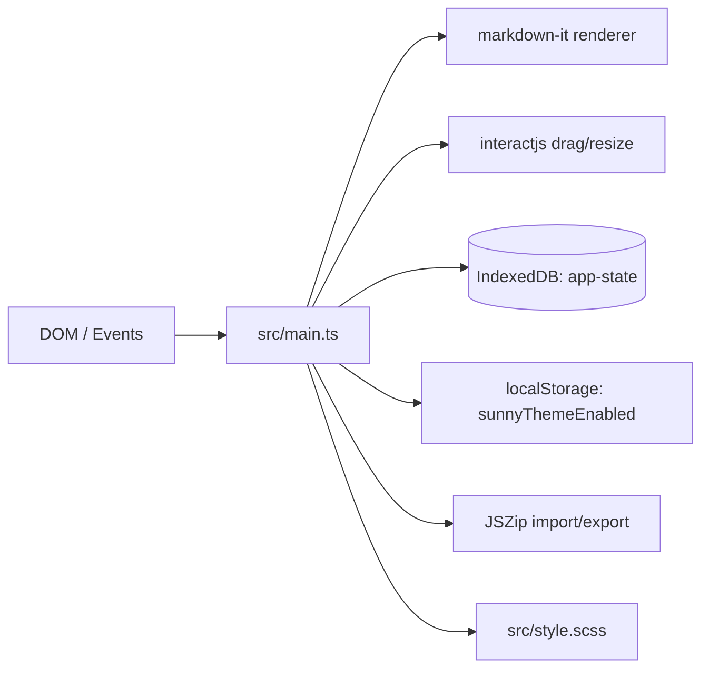
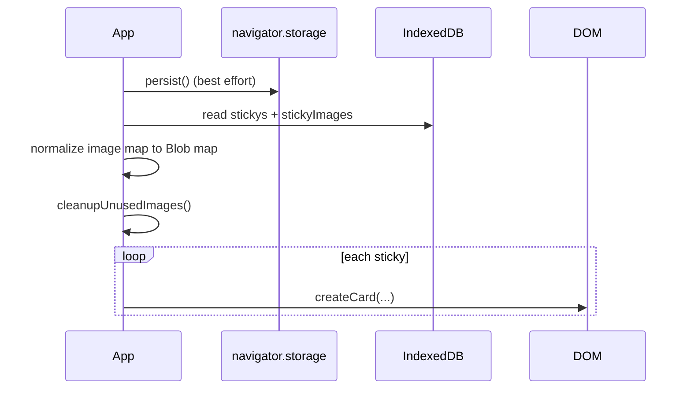
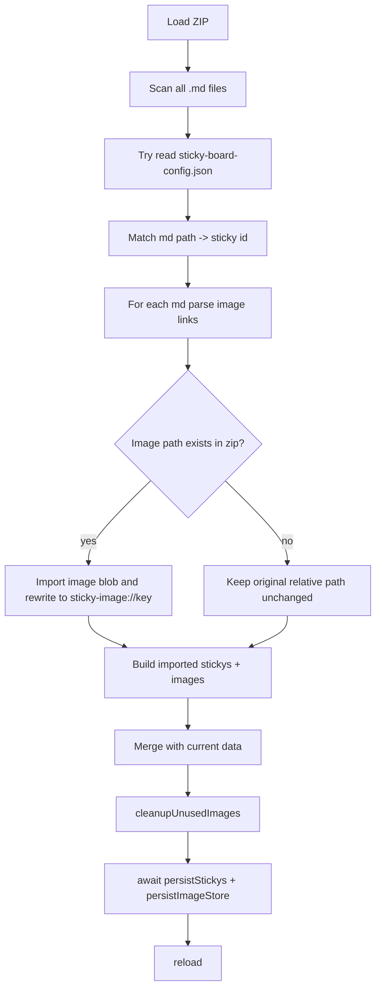

# Sticky Board Architecture

This document reflects the current implementation in `src/main.ts` and `src/style.scss`.
It is written so an engineer (or AI) can rebuild the app behavior with minimal ambiguity.

## 1. System Overview

Sticky Board is a browser-only sticky-note app with:

- Markdown notes (edit + preview)
- Drag/resize interactions (grid-snapped)
- Pasted image support (Blob storage)
- IndexedDB persistence for notes/images
- ZIP import/export (`.md + images + sticky-board-config.json`)
- Timeline layout mode
- Optional Sunny visual theme (video overlay)

No backend, no user account, no remote sync.

## 2. Runtime Architecture



## 3. Data Model

```ts
type Sticky = {
  x: number;
  y: number;
  width: number;   // rem
  height: number;  // rem
  zIndex: number;
  text: string;    // markdown source
};

type Stickys = Record<string, Sticky>;
```

In-memory stores:

- `stickys: Stickys`
- `imageStore: Record<string, Blob>`
- `imageUrlCache: Map<string, string>` (Object URL cache for rendering)
- `cardElementMap: Map<string, HTMLDivElement>`

State ownership:

- `stickys` is the single source of truth for card geometry (`x/y/width/height/zIndex`)
- `applyCardGeometry()` projects model geometry onto a card element; `commitCardGeometry()` mutates the model and re-projects it
- Cards do not mirror geometry into `data-xy` / `data-size` / `data-zindex` attributes
- Edit state is read through `isCardEditing(card)` instead of checking `textarea.style.display` at each call site
- Timeline state is derived from `body.layout-timeline` through `isTimelineLayout()`; there is no separate boolean flag
- DOM ids: the card element id is the sticky id, and its textarea id is `${id}-input`

Image reference format in markdown:

- ``

Image key convention:

- `[stickyID]-[imageID]`

## 4. Persistence Model

### 4.1 IndexedDB

- DB: `sticky-board-db`
- Version: `1`
- Store: `app-state` (`keyPath: key`)
- Keys:
  - `stickys`
  - `stickyImages`

Persisted values:

- `stickys` => `Stickys`
- `stickyImages` => `Record<string, Blob>`

Connection and write policy:

- `openAppDb()` caches the connection; transactions never close it (reset on
  `versionchange`/`close`)
- `updateSticky()` only mutates the in-memory model and calls `schedulePersistStickys()`
- `schedulePersistStickys()` debounces writes by `PERSIST_DEBOUNCE_MS` (300ms), so
  drag/resize moves and keystrokes do not trigger one IndexedDB transaction each
- `flushPersistStickys()` writes immediately when a debounced write is pending; it runs
  on `visibilitychange` (hidden) and `beforeunload`
- ZIP import cancels the pending debounce and `await`s `persistStickys()` /
  `persistImageStore()` before reloading
- Image-store writes stay immediate because they only change on paste/cleanup/import

### 4.2 localStorage

Only setting key is stored in localStorage:

- `sunnyThemeEnabled`

No localStorage->IndexedDB migration remains in current code.

## 5. Startup Sequence



Key functions:

- `bootstrap()` runs at the end of the module, after settings UI and helpers are set up
- `bindGlobalEvents()` registers visibility, Escape and unload listeners
- `initializeState()` loads storage, cleans images and renders cards
- `getRequiredElement()` throws a descriptive error when `#root` or `#settings` is missing

## 6. Rendering Pipeline

### 6.1 Markdown Rendering

Engine: `markdown-it` with:

- `html: true`
- `linkify: true`
- `breaks: true`

Custom rules:

- Link rule: forces `target="_blank"` + `rel="noopener noreferrer"`
- Image rule:
  - If src starts with `sticky-image://`, lookup `imageStore[key]`
  - Convert Blob -> Object URL (cached)
  - If missing image, fallback alt to `[missing image]`
- Fence / code_block rules: wrap code blocks into `.code-block` with a copy button
  (see 6.4)

### 6.2 Card Modes

- Edit mode: `textarea` visible
- Preview mode: `.preview` visible (HTML from markdown)
- `Escape` exits edit mode for any card still editing (needed when a maximized card
  covers the whole canvas, so there is no blank area left to click)
- Card chrome (`.card-actions`, top-right): edit/preview toggle + maximize/restore +
  delete button

Global click behavior:

- Click blank area (`#root` / `body`) => all cards switch to preview
- On that same blank click, run `cleanupUnusedImages()`

### 6.3 Image Fullscreen Preview

- Clicking image inside preview opens modal overlay
- Close by background click or `Escape`

### 6.4 Code Block Copy

Fenced blocks (```lang) and indented blocks render as:

```
<div class="code-block">
  <button class="copy-code-btn">copy icon</button>
  <pre><code class="language-xxx">escaped code</code></pre>
</div>
```

- `.code-block` is a two-column grid: `pre` in `1 / 1`, the copy button in `1 / 2`,
  and the tinted background/padding live on the wrapper, so the button sits outside the
  scrolling area and never overlaps long or horizontally scrolled code
- Code text is escaped with `md.utils.escapeHtml`; no syntax highlighter dependency
- Copy handler is delegated on `.preview`, so it keeps working after `innerHTML` refresh
- Button click calls `preventDefault()` + `stopPropagation()` to avoid opening image preview
  or bringing the card to front
- Clipboard: `navigator.clipboard.writeText`, falling back to a temporary `textarea`
  + `document.execCommand("copy")` when the Clipboard API is unavailable (e.g. http)
- Feedback: icon swaps to `LucideCopyCheck` and turns green (`#16a34a`), `.copied` plays
  `copy-pop` for ~0.35s, then icon/label/color restore after 1.5s; timer per button is
  kept in a `WeakMap`
- `prefers-reduced-motion: reduce` disables the animation

### 6.5 Card Actions and Maximize

Buttons live in `.card-actions` inside the top border strip (`1.4rem` tall):

- `.card-edit-btn`: toggles edit/preview for that card. Shows `LucideSquarePen` while
  previewing (click to edit) and `LucideEye` while editing (click to preview); label and
  `aria-label` follow the action. `syncEditToggleButton()` re-syncs the icon whenever the
  mode changes from elsewhere (right-click, Esc, blank-area click, initial render)
- `.card-maximize-btn`: maximize/restore, icon swaps between `LucideMaximize` and
  `LucideMinimize`, label between "最大化" and "还原" (localized)
- `.card-close-btn`: delete with confirm, icon is `LucideX`
- All three use the same `1.4rem` hit area as the code-block copy button; the close icon
  is `1.3rem` and stays vertically centered in the top strip via flex
  `align-items: center`

Maximize behavior:

- State is only the transient class `card-maximized`; nothing is added to the persisted
  `Sticky` model, so a reload restores the saved `x/y/width/height`
- CSS: `position: fixed`, `100dvw x 100dvh`, `transform: none !important`,
  `z-index: 6100 !important` (above `#settings` at `6000`, below the image preview
  overlay at `9999`), hidden `.resize`, larger `textarea`/`.preview` padding
- Images in a maximized card are capped at `max-width: 50vw` instead of full width
- Animation: `.card` transitions `all 0.2s ease-in-out`; `.card-maximized` keeps
  `max-width: 100dvw` / `max-height: 100dvh` instead of `none`, so max constraints
  interpolate together with width/height — `none` is not animatable and makes restore
  snap to `50rem` before sliding. `body.move .card { transition: none }` disables
  transitions during drag/resize so cards track the pointer without lag
- Docked (timeline) cards need an extra step: they are flow-positioned with
  `transform: none !important`, so the absolute/fixed switch is not animatable and the
  card would jump to the viewport corner. `animateDockedMaximize()` temporarily limits
  the inline transition to size properties, applies a `translate` FLIP offset from the
  old rect, then animates it to `0 0` while size keeps transitioning. Free-layout cards
  keep the simpler path because their `transform` interpolation already provides the
  motion
- Only one card can be maximized at a time; maximizing another card restores the previous one
- While maximized, drag and resize listeners bail out via `isCardTransformLocked()`
  (`isTimelineLayout() || .card-maximized`), so geometry stays untouched
- Timeline mode keeps the same card chrome: `.layout-docked` shares the normal card
  styles apart from `max-height: 20rem`, so maximize/delete buttons stay visible and
  usable. It also hides the invisible `.resize` handle, so interact.js no longer
  registers resize edges or sets the `nwse-resize` cursor

## 7. Interaction Model

### 7.1 Create Card by Dragging Empty Canvas

- `mousedown` on `#root` starts draw mode (only if target is root itself)
- `mousemove` shows dashed shadow box
- `mouseup` creates card if >= `160px x 160px`
- Dimensions are converted to rem via `/16`
- During creation drag, `user-select` is disabled globally to prevent text selection artifacts

### 7.2 Move/Resize Cards

Using `interactjs`:

- Resize handle: `.resize`
- Restrict edges to parent
- Drag snap: `16px` grid
- Drag restriction: within `#root`
- On drag/resize start: `bringCardToFront()`
- On move/end: `commitCardGeometry()` updates the model first, then projects
  `x/y/width/height` onto the card

### 7.3 Edit Entry

- Right-click card enters edit mode (except delete button/resize handle)
- `.card-edit-btn` in the top bar toggles edit/preview without needing a context menu
- Left click card brings it to top z-index

### 7.4 Card Action Buttons

- Buttons call `stopPropagation()`, so they never bring the card to front or start a drag
- Maximize/restore keeps the saved geometry; delete re-renders the timeline when docked

## 8. Timeline Layout Mode

Toggle source: layout button in settings.

When enabled (`layout-timeline` class):

- Cards are grouped by day from ID timestamp prefix
- Ordered newest-first
- Timeline panel renders `date marker + card row`
- Cards become `layout-docked` and arranged in flow layout
- Root background dot pattern is removed
- Timeline hint text is shown at top

Special interaction in timeline mode:

- Double-click any card:
  - exit timeline mode
  - bring that card to top
  - move it to viewport center (snapped to 16px grid)

Toggle animation (`setLayoutMode` + `animateCardLayoutChange`):

- Capture each card's viewport rect before the layout change
- Disable `transition` on cards, apply the docked/free layout, then measure new rects
- Set a FLIP offset through the standalone `translate` property (independent of the
  inline `transform` used for free positioning and of `.layout-docked`'s
  `transform: none !important`)
- On the next frame restore transitions and animate `translate` to `0 0`, so cards glide
  from their old position to the new one in both directions

## 9. Image Lifecycle

### 9.1 Paste

Inside textarea `paste` handler:

1. Extract first `image/*` clipboard item
2. Enforce size limit (`MAX_PASTED_IMAGE_SIZE = 20MB`)
3. Create image key and save Blob to `imageStore`
4. Persist image store
5. Insert markdown ``
6. Persist sticky text

### 9.2 Cleanup Strategy

`cleanupUnusedImages()` parses all markdown text for `sticky-image://` keys.

- Unreferenced image keys are deleted from `imageStore`
- Corresponding object URLs are revoked
- Image store is persisted if changed

Cleanup is intentionally triggered on blank-area click (preview switch), not on every edit keystroke.

## 10. ZIP Export Format

Trigger: Export button.

File name:

- `sticky-board-{Date.now()}.zip`

Archive contents:

- `/{id}.md` for each sticky
- `/images/{asset-id}.{ext}` for pasted images
- `/sticky-board-config.json`

`sticky-board-config.json` shape:

```json
{
  "id1": { "x": 0, "y": 0, "width": 20, "height": 10, "zIndex": 1, "path": "./id1.md" },
  "id2": { "x": 16, "y": 16, "width": 20, "height": 10, "zIndex": 2, "path": "./id2.md" }
}
```

Export markdown rewrite:

- `sticky-image://<key>` => `./images/<asset-id>.<ext>`

Goal: extracted folder can be opened in VS Code and markdown preview can load images through relative paths.

## 11. ZIP Import Behavior

Trigger: Import button (accepts `.zip`).



ID resolution rules:

1. Try config path mapping (`path` in config)
2. If no mapping, generate new ID from `Date.now()` base, incremented by `+100ms` per new file to avoid collisions

Default layout for md without config:

- Slight offsets: `(10,10)`, `(20,20)`, `(30,30)` ...
- Width/height defaults to `20/10`
- zIndex increments from current max

If image file referenced by relative path is missing in zip:

- Leave original markdown image path untouched

## 12. Settings Panel

Settings items:

- Sunny toggle
- Export button
- Import button
- Layout toggle icon
- Settings icon
- GitHub link

Expand/collapse behavior:

- Staggered pop-in/pop-out animation
- Bottom item appears first
- Most actions auto-collapse settings after click/change

## 13. Theming and Visual Layers

- Sunny overlay uses `leaves.mp4` as fixed full-screen video
- Playback is paused/resumed by visibility state
- Reduced motion media query disables overlay
- Card/scrollbar/timeline styles are in `src/style.scss`

## 14. Key Invariants

- `sticky-image://` is the only internal image URI scheme
- `imageStore` must be Blob-based in memory and IndexedDB
- `bringCardToFront()` is the canonical z-index elevation path
- Timeline mode and free-layout mode are mutually exclusive render states
- Import persistence must finish (`await`) before page reload

## 15. Rebuild Order (Recommended)

1. Core types and i18n text table
2. IndexedDB adapter (`open/read/write`)
3. Markdown renderer overrides
4. Card factory + edit/preview toggle
5. Paste image pipeline + image URI scheme
6. Drag/create/move/resize interactions
7. Settings panel + sunny theme + layout mode
8. Image cleanup and object URL lifecycle
9. ZIP export
10. ZIP import (path mapping, fallback IDs/default layout)
11. Startup bootstrap and final integration checks

## 16. Code Quality Gates

- `lint:check` — ESLint flat config (`eslint.config.mjs`, `@eslint/js` + `typescript-eslint`)
- `lint` — same as above with `--fix`
- `typecheck` — `tsc -b`
- `check` — `npm run lint:check && npm run typecheck`
- `build` — `npm run check && vite build` (lint + types are enforced on deploy too)
- `prepare` runs `husky`, which wires `.husky/pre-commit` to `npm run check` and
  `npx lint-staged`
- lint-staged runs `eslint --fix --no-warn-ignored` on staged `js/jsx/ts/tsx/mjs/cjs`
  files, so lint errors block the commit while fixable issues are auto-fixed
- Project scripts assume npm (`npm run <script>`) because that is what the deployment
  environment uses
