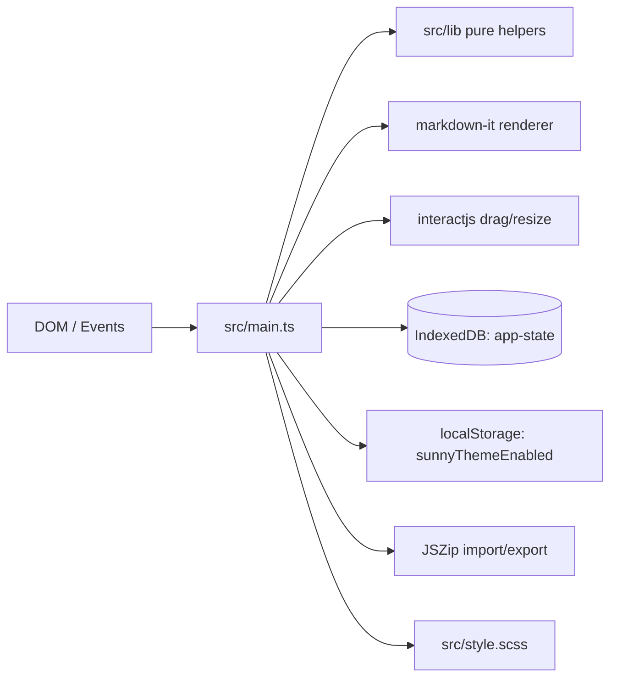
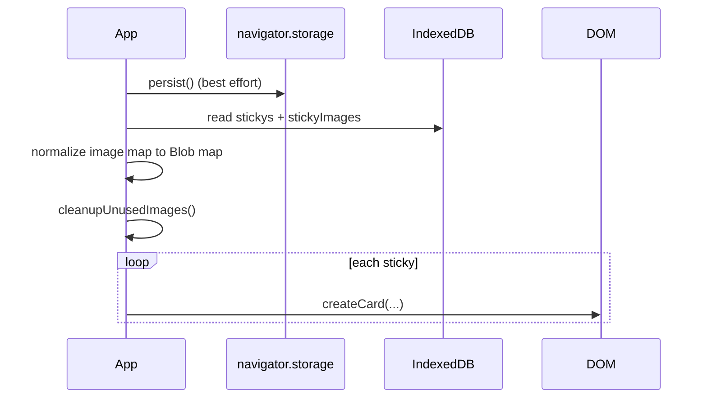
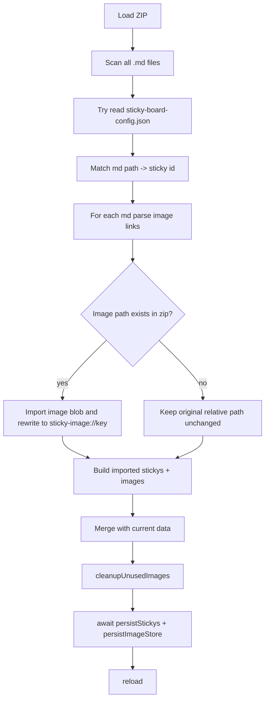

# Sticky Board 架构

本文档反映 `src/main.ts`、`src/lib/` 与 `src/style.scss` 的当前实现。
编写目标是让工程师（或 AI）能以尽可能少的歧义重建应用行为。

## 1. 系统概览

Sticky Board 是一个纯浏览器端的便签应用，包含：

- Markdown 便签（编辑 + 预览）
- 拖拽/缩放交互（网格吸附）
- 粘贴图片支持（Blob 存储）
- 便签/图片的 IndexedDB 持久化
- ZIP 导入/导出（`.md + images + sticky-board-config.json`）
- 时间轴布局模式
- 可选的 Sunny 视觉主题（视频遮罩层）

没有后端、没有用户账号、没有远程同步。

## 2. 运行时架构



## 3. 数据模型

```ts
type Sticky = {
  x: number;
  y: number;
  width: number;   // rem
  height: number;  // rem
  zIndex: number;
  text: string;    // markdown source
};

type Stickys = Record<string, Sticky>;
```

内存中的存储：

- `stickys: Stickys`
- `imageStore: Record<string, Blob>`
- `imageUrlCache: Map<string, string>`（用于渲染的 Object URL 缓存）
- `cardElementMap: Map<string, HTMLDivElement>`

状态归属：

- `stickys` 是卡片几何信息（`x/y/width/height/zIndex`）的唯一事实源
- `applyCardGeometry()` 把模型中的几何信息投影到卡片元素上；`commitCardGeometry()` 先修改模型，再重新投影
- 卡片不再把几何信息镜像到 `data-xy` / `data-size` / `data-zindex` 属性
- 编辑状态统一通过 `isCardEditing(card)` 读取，而不是在每个调用点检查 `textarea.style.display`
- 时间轴状态通过 `isTimelineLayout()` 从 `body.layout-timeline` 派生，没有额外的布尔标志
- DOM id：卡片元素 id 就是 sticky id，其 textarea id 为 `${id}-input`

Markdown 中的图片引用格式：

- ``

图片 key 约定：

- `[stickyID]-[imageID]`

## 4. 持久化模型

### 4.1 IndexedDB

- DB：`sticky-board-db`
- Version：`1`
- Store：`app-state`（`keyPath: key`）
- Keys：
  - `stickys`
  - `stickyImages`

持久化的值：

- `stickys` => `Stickys`
- `stickyImages` => `Record<string, Blob>`

连接与写入策略：

- `openAppDb()` 会缓存连接；事务不会关闭连接（在 `versionchange`/`close` 时重置）
- `updateSticky()` 只修改内存模型，并调用 `schedulePersistStickys()`
- `schedulePersistStickys()` 按 `PERSIST_DEBOUNCE_MS`（300ms）防抖写入，因此拖拽/缩放移动和键盘输入不会各自触发一次 IndexedDB 事务
- `flushPersistStickys()` 在存在待写入防抖任务时立即写入；它会在 `visibilitychange`（hidden）和 `beforeunload` 时运行
- ZIP 导入会取消待执行的防抖任务，并在刷新前 `await` `persistStickys()` / `persistImageStore()`
- 图片存储的写入保持立即执行，因为它只在粘贴/清理/导入时变化

### 4.2 localStorage

localStorage 中只存储一个设置 key：

- `sunnyThemeEnabled`

当前代码中不再保留 localStorage -> IndexedDB 的迁移逻辑。

## 5. 启动流程



关键函数：

- `bootstrap()` 在模块末尾运行，此时设置 UI 和辅助函数已就绪
- `bindGlobalEvents()` 注册 visibility、Escape 和 unload 监听
- `initializeState()` 加载存储、清理图片并渲染卡片
- `getRequiredElement()` 在 `#root` 或 `#settings` 缺失时抛出带说明的错误

## 6. 渲染管线

### 6.1 Markdown 渲染

引擎：`markdown-it`，配置为：

- `html: true`
- `linkify: true`
- `breaks: true`

自定义规则：

- `renderPreview()` 先在惰性的 `<template>` 中解析渲染结果，为其中的 ``（包括 Markdown 图片和原样 HTML 图片）统一设置 `referrerpolicy="no-referrer"`，再插入预览区域。全屏图片预览也在设置 `src` 前应用同样的策略。
- 外部图片仍会向其来源发起请求，图片请求省略 `Referer` 请求头。`html: true` 保留原样 HTML 支持，请仅导入可信来源的 Markdown 和 ZIP。

- Link 规则：强制 `target="_blank"` + `rel="noopener noreferrer"`
- Image 规则：
  - 如果 src 以 `sticky-image://` 开头，则查询 `imageStore[key]`
  - 把 Blob 转换为 Object URL（带缓存）
  - 如果图片缺失，把 alt 回退为本地化的 `missingImage` 文案
- Fence / code_block 规则：把代码块包装为带复制按钮的 `.code-block`
  （见 6.4）

### 6.2 卡片模式

- 编辑模式：`textarea` 可见
- 预览模式：`.preview` 可见（由 Markdown 生成的 HTML）
- `Escape` 会让仍处于编辑状态的卡片退出编辑模式（当最大化卡片铺满整个画布、没有空白区域可点击时需要）
- 卡片控制区（`.card-actions`，右上角）：编辑/预览切换 + 最大化/还原 + 删除按钮

全局点击行为：

- 点击空白区域（`#root` / `body`）=> 所有卡片切换到预览模式
- 在同一次空白点击中，运行 `cleanupUnusedImages()`

### 6.3 图片全屏预览

- 点击预览中的图片会打开模态遮罩层
- 通过点击背景或 `Escape` 关闭

### 6.4 代码块复制

围栏代码块（```lang）与缩进代码块会渲染为：

```
<div class="code-block">
  <button class="copy-code-btn">copy icon</button>
  <pre><code class="language-xxx">escaped code</code></pre>
</div>
```

- `.code-block` 是两列 grid：`pre` 位于 `1 / 1`，复制按钮位于 `1 / 2`，带底色的背景和内边距位于包裹层上，因此按钮位于滚动区域之外，永远不会遮挡长代码或水平滚动的代码
- 代码文本通过 `md.utils.escapeHtml` 转义；不引入语法高亮依赖
- 复制处理逻辑委托在 `.preview` 上，因此替换预览内容后仍然有效
- 按钮点击调用 `preventDefault()` + `stopPropagation()`，避免打开图片预览或把卡片置顶
- 剪贴板：使用 `navigator.clipboard.writeText`，当 Clipboard API 不可用时（例如 http）回退到临时 `textarea` + `document.execCommand("copy")`
- 反馈：图标切换为 `LucideCopyCheck` 并变绿（`#16a34a`），`.copied` 播放约 0.35s 的 `copy-pop` 动画，然后图标/标签/颜色在 1.5s 后恢复；每个按钮的 timer 保存在 `WeakMap` 中
- `prefers-reduced-motion: reduce` 会禁用动画

### 6.5 卡片操作按钮与最大化

按钮位于顶部边框条（高 `1.4rem`）内的 `.card-actions` 中：

- `.card-edit-btn`：切换该卡片的编辑/预览。预览时显示 `LucideSquarePen`（点击进入编辑），编辑时显示 `LucideEye`（点击进入预览）；label 和 `aria-label` 跟随动作变化。当模式从其他入口（右键、Esc、点击空白区域、初始渲染）变化时，`syncEditToggleButton()` 会重新同步图标
- `.card-maximize-btn`：最大化/还原，图标在 `LucideMaximize` 和 `LucideMinimize` 之间切换，label 在"最大化"和"还原"之间切换（已本地化）
- `.card-close-btn`：确认后删除，图标为 `LucideX`
- 三个按钮与代码块复制按钮使用相同的 `1.4rem` 点击区域；关闭图标为 `1.3rem`，通过 flex 的 `align-items: center` 在顶部条中垂直居中

最大化行为：

- 状态只是临时 class `card-maximized`；不会写入持久化的 `Sticky` 模型，因此刷新后会恢复已保存的 `x/y/width/height`
- CSS：`position: fixed`、`100dvw x 100dvh`、`transform: none !important`、`z-index: 6100 !important`（高于 `#settings` 的 `6000`，低于图片预览遮罩层的 `9999`），隐藏 `.resize`，增大 `textarea`/`.preview` 的内边距
- 最大化卡片中的图片限制为 `max-width: 50vw`，而不是全宽
- 动画：`.card` 过渡 `all 0.2s ease-in-out`；`.card-maximized` 保留 `max-width: 100dvw` / `max-height: 100dvh` 而不是 `none`，使 max 约束与 width/height 一起插值——`none` 不可动画，会导致还原时先跳到 `50rem` 再滑动。`body.move .card { transition: none }` 在拖拽/缩放期间禁用过渡，让卡片跟手且无延迟
- 停靠态（时间轴）卡片需要额外一步：它们使用流式布局并带 `transform: none !important`，因此 absolute/fixed 切换不可动画，卡片会跳到视口角落。`animateDockedMaximize()` 先把内联 transition 限制为尺寸属性，再把位置补偿交给 `animateFlipFrom()`，也就是时间轴切换使用的同一个 FLIP 辅助函数。自由布局卡片保留更简单的路径，因为它们的 `transform` 插值已经提供运动效果
- 同一时间只能最大化一张卡片；最大化另一张会还原前一张
- 最大化期间，拖拽和缩放监听通过 `isCardTransformLocked()`（`isTimelineLayout() || .card-maximized`）直接退出，因此几何信息保持不变
- 时间轴模式保留相同的卡片外观：`.layout-docked` 除 `max-height: 20rem` 外沿用普通卡片样式，因此最大化/删除按钮仍然可见可用。它还会隐藏不可见的 `.resize` 手柄，使 interact.js 不再注册缩放手柄边缘，也不再设置 `nwse-resize` 光标
- 退出时间轴布局时，`restoreFromLayoutMode()` 会把仍处于 `card-maximized` 的停靠卡片还原为普通尺寸，避免它们以固定定位继续覆盖视口

## 7. 交互模型

### 7.1 在空白画布上拖拽创建卡片

- 在 `#root` 上 `mousedown` 进入绘制模式（仅当 target 是 root 本身）
- `mousemove` 显示虚线阴影框
- 当尺寸 >= `MIN_CARD_SIZE_PX x MIN_CARD_SIZE_PX` 时，`mouseup` 创建卡片
- 尺寸通过 `/ REM_IN_PX` 转换为 rem
- 创建拖拽期间全局禁用 `user-select`，避免文本选择产生的视觉残留
- 切换到时间轴布局时 `setLayoutMode()` 会调用 `finishCreateDragging()`，清理残留的绘制阴影与 `user-select` 锁定

### 7.2 移动/缩放卡片

使用 `interactjs`：

- 缩放手柄：`.resize`
- 将边缘限制在父容器内
- 拖拽吸附：`GRID_SIZE` 网格
- 拖拽限制：在 `#root` 内
- 拖拽 `ignoreFrom`：`textarea, .preview, .card-actions`，编辑区与操作按钮不会启动拖拽
- 拖拽/缩放开始时：`bringCardToFront()`
- 移动/结束时：`commitCardGeometry()` 先更新模型，再把 `x/y/width/height` 投影到卡片

### 7.3 进入编辑

- 右键卡片进入编辑模式（删除按钮/缩放手柄除外）
- 顶栏 `.card-edit-btn` 无需右键菜单即可切换编辑/预览
- `setCardEditing(card, editing)` 是顶栏切换和点击空白区域预览动作的唯一实现
- 进入编辑模式后在下一帧（`requestAnimationFrame`）聚焦 textarea，避免固定 200ms 延迟抢走用户已转移的焦点
- 左键点击卡片会把它提升到最高 z-index

### 7.4 卡片操作按钮

- 三个按钮都由 `createCardAction()` 根据图标、label 和 handler 构建
- 按钮调用 `stopPropagation()`，因此不会把卡片置顶或启动拖拽
- 最大化/还原会保留已保存的几何信息；停靠态删除会重新渲染时间轴

## 8. 时间轴布局模式

切换入口：设置面板中的 layout 按钮。

启用时（`layout-timeline` class）：

- 卡片按 ID 时间戳前缀分组到天
- 按最新优先排序
- 时间轴面板渲染 `date marker + card row`
- 卡片变为 `layout-docked` 并按流式布局排列
- 移除根背景点阵图案
- 顶部显示时间轴提示文字

时间轴模式下的特殊交互：

- 双击任意卡片：
  - 退出时间轴模式
  - 把该卡片置顶
  - 移动到视口中心（吸附到 `GRID_SIZE`）
  - 若停靠卡片处于最大化状态会一并还原（见 6.5）

切换动画（`setLayoutMode` + `animateFlipFrom`）：

- 布局变化前记录每张卡片的视口 rect
- 禁用卡片的 `transition`，应用停靠/自由布局，然后测量新的 rect
- 通过独立的 `translate` 属性设置 FLIP 偏移（独立于自由定位使用的内联 `transform`，也独立于 `.layout-docked` 的 `transform: none !important`）
- 下一帧恢复 transition，并把 `translate` 动画到 `0 0`，使卡片在双向切换时都从旧位置滑向新位置
- `animateFlipFrom()` 与停靠态最大化共用，因此两种过渡遵循同一套实现

## 9. 图片生命周期

### 9.1 粘贴

在 textarea 的 `paste` 处理逻辑中：

1. 提取第一个 `image/*` 剪贴板项
2. 执行大小限制（`MAX_PASTED_IMAGE_SIZE = 20MB`）
3. 创建图片 key，并把 Blob 保存到 `imageStore`
4. 持久化图片存储
5. 插入 Markdown ``
6. 持久化便签文本

### 9.2 清理策略

`cleanupUnusedImages()` 会解析所有 Markdown 文本中的 `sticky-image://` key。

- 未被引用的图片 key 会从 `imageStore` 中删除
- 对应的 Object URL 会被 revoke
- 如果有变化，则持久化图片存储

清理是有意放在点击空白区域（切换预览）时触发，而不是每次编辑按键时触发。

## 10. ZIP 导出格式

触发方式：Export 按钮。

文件名：

- `sticky-board-{Date.now()}.zip`

归档内容：

- `/{id}.md`，每个便签一个
- `/images/{asset-id}.{ext}`，用于粘贴图片
- `/sticky-board-config.json`

`sticky-board-config.json` 结构：

```json
{
  "id1": { "x": 0, "y": 0, "width": 20, "height": 10, "zIndex": 1, "path": "./id1.md" },
  "id2": { "x": 16, "y": 16, "width": 20, "height": 10, "zIndex": 2, "path": "./id2.md" }
}
```

导出时 Markdown 重写：

- `sticky-image://<key>` => `./images/<asset-id>.<ext>`

目标：解压后的文件夹可以直接在 VS Code 中打开，Markdown 预览可以通过相对路径加载图片。

## 11. ZIP 导入行为

触发方式：Import 按钮（接受 `.zip`）。



ID 解析规则：

1. 尝试配置路径映射（配置中的 `path`）
2. 如果没有映射，则基于 `Date.now()` 生成新 ID，每个新文件递增 `+100ms` 以避免冲突

没有配置的 md 使用默认布局：

- 轻微偏移：`(10,10)`、`(20,20)`、`(30,30)` ...
- Width/height 默认 `20/10`
- zIndex 从当前最大值递增

导入配置校验（`parseImportedConfig` + `normalizeImportedSticky`）：

- 配置项必须是带字符串 `path` 的对象；id 必须匹配 `[A-Za-z0-9_-]+`，
  因此 `__proto__` 和其他不安全 key 会被忽略
- `x/y` 取整、非负，并限制在 `MAX_IMPORTED_COORDINATE_PX` 内
- `width/height` 取整，并限制在 `MIN_CARD_SIZE_REM`–`MAX_CARD_SIZE_REM` 内
- `zIndex` 取整，并限制在 `1`–`MAX_IMPORTED_Z_INDEX` 内
- 缺失或非有限数字回退到生成的默认布局
- 导入的 Markdown 文本强制为字符串
- 查找前会规范化 ZIP 路径：反斜杠转为斜杠，并解析 `.` / `..` 段

如果 zip 中缺少被相对路径引用的图片文件：

- 保持 Markdown 中原始图片路径不变

## 12. 设置面板

设置项：

- Sunny 开关
- Export 按钮
- Import 按钮
- Layout 切换按钮
- Settings 按钮
- GitHub 链接

Settings 与 Layout 图标是 `<button>`（带 `aria-label`），可键盘聚焦与操作，不再使用不可聚焦的裸 SVG。

展开/收起行为：

- 交错 pop-in/pop-out 动画
- 底部项最先出现
- 大多数操作在点击/切换后自动收起设置面板

## 13. 主题与视觉层级

- Sunny 遮罩层使用 `leaves.mp4` 作为固定全屏视频
- 播放会根据页面可见性状态暂停/恢复
- `prefers-reduced-motion` 媒体查询会禁用遮罩层
- 卡片/滚动条/时间轴样式位于 `src/style.scss`
- 层级顺序集中定义在 `:root` 自定义属性中：

| Variable | Value | 使用位置 |
|---|---|---|
| `--z-card` | 1 | 卡片基础层级和停靠态卡片 |
| `--z-card-control` | 10 | 卡片操作栏和缩放手柄 |
| `--z-code-copy` | 1 | 代码块内的复制按钮 |
| `--z-creating-shadow` | 1000 | 拖拽创建时的阴影框 |
| `--z-sunny-overlay` | 4400 | Sunny 视频遮罩层 |
| `--z-settings` | 6000 | 设置面板 |
| `--z-card-maximized` | 6100 | 最大化卡片 |
| `--z-image-preview` | 9999 | 图片预览遮罩层 |

- 动态卡片堆叠仍使用模型中的 `zIndex`；`applyCardGeometry()` 会把它内联设置到卡片上

## 13.1 布局常量

`src/constants.ts` 集中定义交互和持久化共用的数字：

| Constant | Value | 含义 |
|---|---|---|
| `REM_IN_PX` | 16 | 布局计算假定的每 rem 像素数 |
| `GRID_SIZE` | 16 | 拖拽/创建吸附步长，与 1rem 点阵一致 |
| `MIN_CARD_SIZE_PX` | 160 | 新建卡片的最小 width/height |
| `MIN_CARD_SIZE_REM` | 10 | 导入卡片的最小尺寸 |
| `MAX_CARD_SIZE_REM` | 50 | 导入卡片的最大尺寸，与 CSS 一致 |
| `MAX_IMPORTED_COORDINATE_PX` | 100000 | 导入 `x/y` 上限 |
| `MAX_IMPORTED_Z_INDEX` | 999 | 导入 `zIndex` 上限 |
| `CREATE_DRAG_THRESHOLD_PX` | 5 | 创建阴影出现前的指针移动距离 |
| `PERSIST_DEBOUNCE_MS` | 300 | Stickys 写入防抖 |
| `COPY_FEEDBACK_MS` | 1500 | 复制按钮成功状态持续时间 |
| `EDIT_FOCUS_DELAY_MS` | 200 | textarea 聚焦前的延迟 |
| `SETTINGS_ITEM_ANIMATION_STEP_MS` | 45 | 设置项交错间隔 |
| `SETTINGS_ITEM_ANIMATION_DURATION_MS` | 260 | 设置项动画时长 |

- `Sticky.x/y` 保持像素单位；`Sticky.width/height` 保持 rem 单位
- 换算使用 `REM_IN_PX` 和 `GRID_SIZE`，不再使用裸字面量

## 14. 关键不变量

- `sticky-image://` 是唯一的内部图片 URI scheme
- `imageStore` 在内存和 IndexedDB 中都必须基于 Blob
- `bringCardToFront()` 是提升 z-index 的唯一规范路径
- 时间轴模式和自由布局模式是互斥的渲染状态
- 导入持久化必须在页面刷新前完成（`await`）

## 15. 重建顺序（建议）

1. 核心类型与 i18n 文案表
2. IndexedDB 适配层（`open/read/write`）
3. Markdown 渲染器覆写
4. 卡片工厂 + 编辑/预览切换
5. 粘贴图片管线 + 图片 URI scheme
6. 拖拽/创建/移动/缩放交互
7. 设置面板 + Sunny 主题 + 布局模式
8. 图片清理与 Object URL 生命周期
9. ZIP 导出
10. ZIP 导入（路径映射、回退 ID/默认布局）
11. 启动 bootstrap 与最终集成检查

## 16. 代码质量门禁

- `lint:check` — ESLint flat config（`eslint.config.mjs`、`@eslint/js` + `typescript-eslint`）
- `lint` — 同上，带 `--fix`
- `typecheck` — `tsc -b`
- `test` — `vitest run`，运行 `src/lib/**/*.test.ts`
- `test:watch` — `vitest` 监听模式
- `check` — `pnpm run lint:check && pnpm run typecheck && pnpm run test`
- `build` — `pnpm run check && vite build`（部署时同样强制 lint、类型检查与单元测试）
- 纯函数集中在 `src/lib/`，测试与实现同目录；`vitest` 仅作为 devDependency，
  不进入生产 bundle，也不读取便签、图片或 IndexedDB 数据
- `prepare` 运行 `husky`，把 `.husky/pre-commit` 接到 `pnpm run check` 和
  `pnpm exec lint-staged`
- lint-staged 对暂存的 `js/jsx/ts/tsx/mjs/cjs` 文件运行 `eslint --fix --no-warn-ignored`，因此 lint 错误会阻止提交，可自动修复的问题会被自动修复
- 项目统一使用 pnpm，并提交 `pnpm-lock.yaml`；`pnpm-workspace.yaml` 只用于
  `allowBuilds`（`esbuild`、`@parcel/watcher`）
- Netlify 由 `netlify.toml` 驱动：`pnpm build`、发布 `dist`、Node 24
